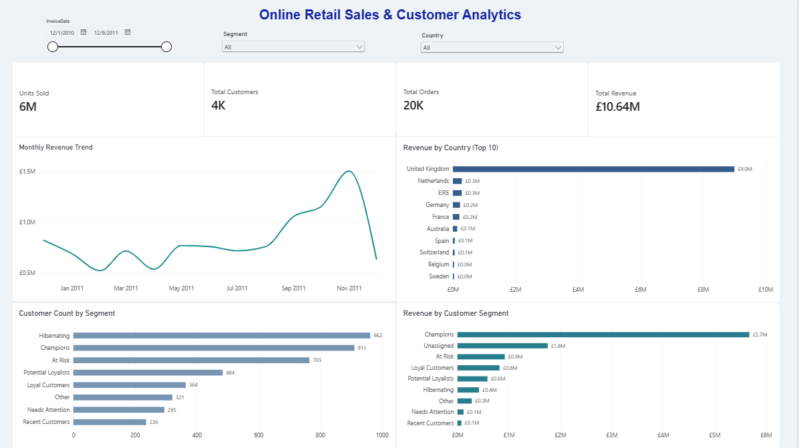

## Power BI Dashboard — Online Retail Sales & Customer Analytics

### Project Overview

This project includes an interactive Power BI dashboard designed to analyze online retail sales performance, revenue trends, country-level performance, and customer segments.

The dashboard transforms transaction-level sales data and RFM-based customer segmentation into actionable business insights through interactive visualizations and key performance indicators (KPIs).

### Dashboard Preview



### Business Objectives

- Monitor overall retail sales and revenue performance.
- Analyze monthly revenue trends and identify peak sales periods.
- Identify the top revenue-generating countries.
- Compare customer counts across RFM segments.
- Evaluate revenue contribution by customer segment.
- Explore business performance using interactive filters.

### Key Performance Indicators

The dashboard displays four headline KPIs:

| KPI             |     Overall Value |
| --------------- | ----------------: |
| Units Sold      |  Approximately 6M |
| Total Customers |  Approximately 4K |
| Total Orders    | Approximately 20K |
| Total Revenue   |           £10.64M |

These figures reflect the overall values displayed in the current dashboard and may change when filters are applied.

### Dashboard Visualizations

**1. Monthly Revenue Trend**

A line chart showing monthly revenue over time, helping identify fluctuations, growth patterns, and seasonal sales peaks.

**2. Revenue by Country (Top 10)**

A horizontal bar chart ranking countries by revenue. The United Kingdom is the leading market, contributing approximately £9.0M in the current dashboard.

**3. Customer Count by Segment**

A comparison of customer counts across RFM-based segments. Hibernating has the highest displayed customer count, at 962, followed by Champions at 911.

**4. Revenue by Customer Segment**

A comparison of revenue contribution across customer segments. Champions is the leading segment, contributing approximately £5.7M in the current dashboard.

The dashboard also includes an Unassigned category for revenue that does not have a matching customer segment. This category should be investigated before drawing conclusions about customer-level performance.

### Interactive Features

Users can explore the report using three filters:

- **InvoiceDate:** Select a date range to analyze sales over a specific period.
- **Country:** Focus on an individual market.
- **Segment:** Examine a particular customer group.

The KPI cards and relevant visualizations respond to the selected filters, enabling interactive business analysis.

### Tools and Technologies

- **Microsoft Power BI Desktop:** Dashboard design and data visualization.
- **Power Query:** Data preparation and transformation.
- **DAX:** Measures and calculated columns.
- **RFM Analysis:** Customer segmentation based on Recency, Frequency, and Monetary value.
- **Git and GitHub:** Version control and project documentation.

### Data Model

The Power BI model includes the following tables:

- `sales_clean` — Transaction-level sales records.
- `customer_rfm` — Customer-level RFM metrics and segment assignments.
- `rfm_segment_summary` — Aggregated customer segment information.

The model combines sales performance with customer segmentation to support market-level and customer-level analysis.

### Key Findings

Based on the current dashboard:

- The United Kingdom is the strongest revenue-generating country.
- Champions contributes the highest revenue among the displayed customer segments.
- Hibernating has the largest displayed customer count.
- Monthly revenue reaches its highest displayed point in November 2011.
- Unassigned revenue highlights an area for further data-quality investigation.

These findings describe the current report and should be interpreted alongside the selected filters and data preparation rules.

### Repository Structure

```text
ecommerce-sales-analysis/
├── data/
├── notebooks/
├── reports/
│   └── Online_Retail_Dashboard.pbix
├── visuals/
│   └── dashboard-preview.png
├── README.md
└── .gitignore
```

### How to Run the Dashboard

1. Download `reports/Online_Retail_Dashboard.pbix` from this repository.
2. Open the file using Microsoft Power BI Desktop.
3. Use the Country, Segment, and InvoiceDate filters to explore the data.
4. Compare the KPI cards and visualizations to investigate sales performance and customer behavior.

### Future Improvements

- Investigate and validate the Unassigned customer segment.
- Further validate relationships between the sales and customer tables.
- Add product-level sales and revenue analysis.
- Expand customer retention and purchasing behavior analysis.
- Improve the documentation of data preparation and DAX calculations.

### Author

**Sahel Sepehri**

Data Analytics Portfolio Project
